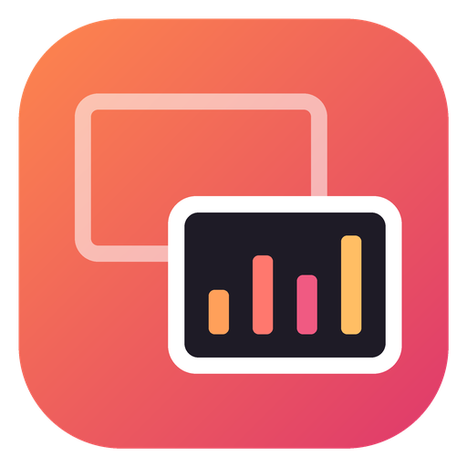
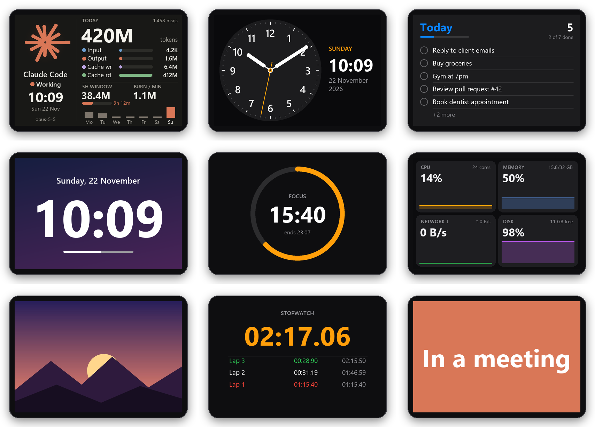
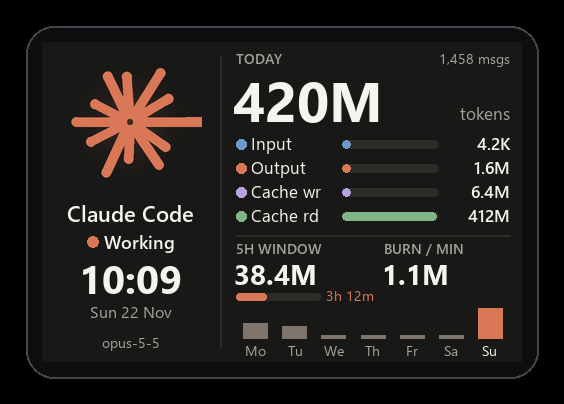
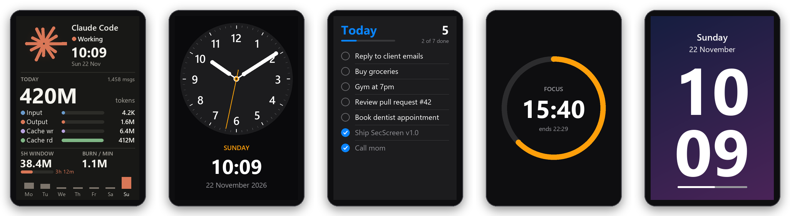
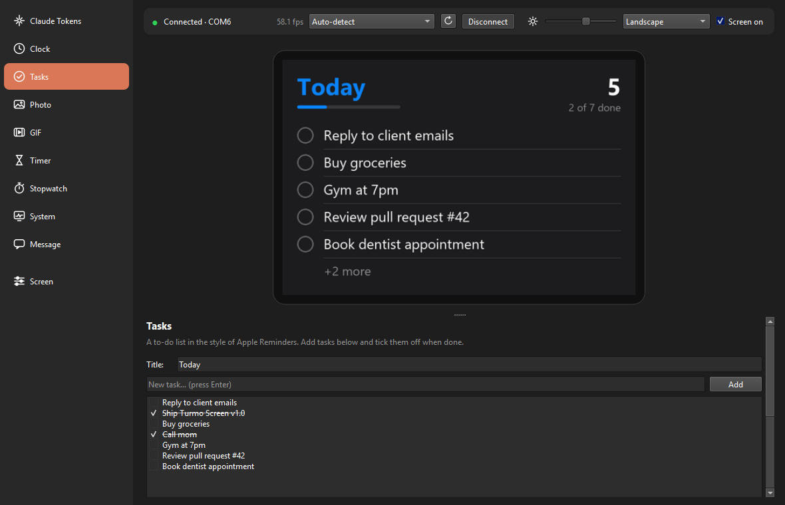
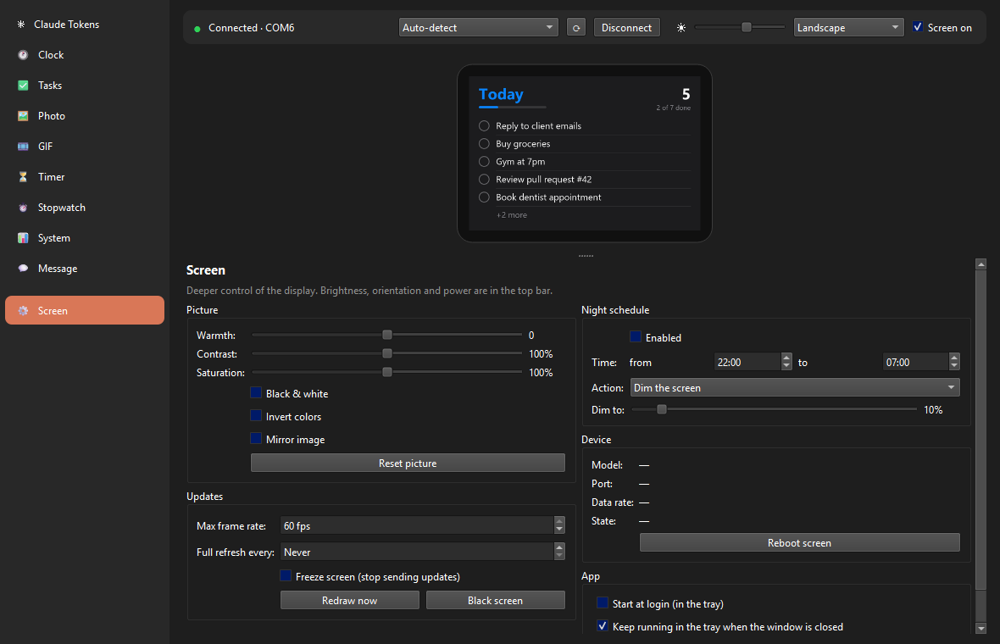
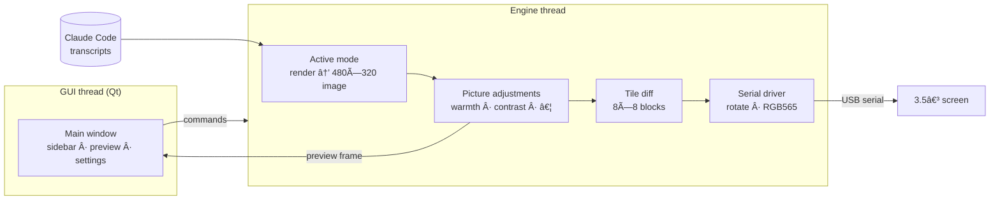

<div align="center">



# SecScreen

**Turn a cheap 3.5″ USB smart screen into a live Claude Code dashboard, clock, to-do list, photo frame and more.**

A cross-platform desktop app with a proper window, live preview and tray icon —
for **Windows**, **macOS** and **Linux**.


</div>

---

## Contents

- [Highlights](#highlights)
- [Display modes](#display-modes)
- [The app](#the-app)
- [Supported hardware](#supported-hardware)
- [Platform support](#platform-support)
- [Installation](#installation)
- [Usage](#usage)
- [Performance](#performance)
- [How it works](#how-it-works)
- [Project structure](#project-structure)
- [Adding your own mode](#adding-your-own-mode)
- [Troubleshooting](#troubleshooting)
- [License](#license)
- [Acknowledgements](#acknowledgements)

---

## Highlights

- 🧠 **Live Claude Code token monitor** — today's usage, the 5-hour window, burn rate and a 7-day chart, read straight from Claude Code's local transcripts. An animated spark ripples while Claude is working.
- 🖥️ **9 display modes** — Claude Tokens, Clock, Tasks, Photo, GIF, Timer, Stopwatch, System monitor and Message.
- 🔄 **Landscape and portrait** — every mode has its own layout for both, plus flipped variants for any mounting position.
- ⚡ **Up to ~60 fps** — only the 8×8 tiles that changed are sent to the screen, so small animations run smoothly on a slow USB link.
- 🎛️ **Deep screen control** — brightness, power, warmth, contrast, saturation, grayscale, invert, mirror, frame-rate cap, freeze, periodic full refresh, night schedule and firmware reboot.
- 🪟 **A real desktop app** — live preview, drag-and-drop photos and GIFs, tray / menu-bar icon, start at login, auto-reconnect when the screen is unplugged.
- 🌍 **Cross-platform** — one Python codebase for Windows, macOS and Linux, packaged as a native `.exe` / `.app` with PyInstaller.

---

## Display modes

<p align="center">
  
</p>

| Mode | What it shows |
|---|---|
| ✳ **Claude Tokens** | Tokens used today (input, output, cache write, cache read), messages, the current 5-hour window with time to reset, burn rate per minute and the last 7 days. The spark animates while Claude Code is working and breathes when idle. |
| 🕐 **Clock** | An analog clock in the style of the macOS Clock widget with a smooth sweeping second hand, or a large lock-screen-style digital clock. Dark and light themes, 12/24-hour. |
| ✅ **Tasks** | A to-do list in the style of Apple Reminders — add tasks, tick them off, reorder by dragging, six accent colors, dark/light theme, progress counter. |
| 🖼 **Photo** | A single photo or a slideshow, cropped to fill or fitted on a blurred backdrop. |
| 🎞 **GIF** | Animated GIF / WebP / PNG playback with original frame timing, speed control and several GIFs in rotation. |
| ⏳ **Timer** | Countdown with a progress ring and presets. Flashes, beeps and sends a notification when time is up. |
| ⏱ **Stopwatch** | Stopwatch with laps; fastest and slowest laps highlighted. |
| 📊 **System** | CPU, memory, network and disk usage with live graphs. |
| 💬 **Message** | Your own text, auto-sized to fill the screen — "In a meeting", "Do not disturb"… |

### Live animation

<p align="center">
  
</p>

### Portrait

Every mode has a dedicated portrait layout — not a squeezed landscape one.

<p align="center">
  
</p>

### Themes

<p align="center">
  
  
  
</p>

---

## The app

A sidebar with the modes, a live preview of exactly what's on the screen, and the selected mode's settings.
The top bar connects to the screen (auto-detected) and controls brightness, orientation and power.

<p align="center">
  
</p>

The **âš™ Screen** page holds the deeper display controls:

<p align="center">
  
</p>

| Section | Options |
|---|---|
| **Picture** | Warmth, contrast, saturation, black & white, invert colors, mirror image |
| **Updates** | Max frame rate (1–60 fps), full refresh every N minutes, freeze screen, black screen, redraw now |
| **Night schedule** | Dim the screen or turn it off between two times |
| **Device** | Detected model, port, live data rate and fps, reboot screen |
| **App** | Start at login (tray only), keep running in the tray when closed, auto-connect on start |

Closing the window keeps SecScreen running in the system tray (menu bar on macOS); quit from the tray icon.
All settings, tasks and playlists are saved automatically.

---

## Supported hardware

SecScreen drives 3.5″ **"Turing" / "UsbMonitor" smart screens** that use the *revision A* serial protocol —
small 320×480 IPS panels sold under many names as "PC case monitor", "AIDA64 sub-screen" or "Turing Smart Screen 3.5″".

| | |
|---|---|
| **USB ID** | `1a86:5722` (serial number `USB35INCHIPSV2`) |
| **Panel** | 3.5″ IPS, 320×480, RGB565 |
| **Connection** | USB serial (CDC-ACM) — `COMx` on Windows, `/dev/cu.usbmodem…` on macOS, `/dev/ttyACM*` on Linux |
| **Detected models** | UsbMonitor 3.5″ (rev A) and Turing 3.5″ (rev A) |

No vendor software or driver is needed. Close the vendor's app first — only one program can use the port at a time.

---

## Platform support

| Platform | Status | Notes |
|---|---|---|
| **Windows 10 / 11** | ✅ Tested with hardware | Standalone `SecScreen.exe` via `build.py` |
| **macOS 11+** | 🟡 Supported, not yet verified on hardware | Native window and menu-bar icon; `SecScreen.app` via `build.py` |
| **Linux** (X11 / Wayland) | 🟡 Supported, not yet verified on hardware | Needs serial-port permission (see below) |

The GUI is Qt 6 (PySide6), so it uses each platform's native look, tray and notifications.
Fonts adapt automatically: Segoe UI on Windows, San Francisco on macOS, DejaVu / Noto on Linux.

---

## Installation

You need **Python 3.9 or newer**. The launch scripts create a local virtual environment and install the
dependencies ([`requirements.txt`](requirements.txt): PySide6, pyserial, Pillow, NumPy, psutil) on first run.

### Windows

```bat
git clone https://github.com/CyberDemon73/secscreen.git
cd secscreen
run.bat
```

### macOS

```bash
git clone https://github.com/CyberDemon73/secscreen.git
cd secscreen
chmod +x run.sh SecScreen.command
./run.sh            # or double-click SecScreen.command in Finder
```

### Linux

```bash
git clone https://github.com/CyberDemon73/secscreen.git
cd secscreen
chmod +x run.sh
./run.sh
```

Allow your user to open the screen (once):

```bash
sudo cp linux/99-secscreen.rules /etc/udev/rules.d/
sudo udevadm control --reload && sudo udevadm trigger
```

The rule also stops ModemManager from probing the device. If Qt reports a missing xcb plugin:
`sudo apt install libxcb-cursor0`.

### Manual setup

```bash
python -m venv .venv
.venv/bin/pip install -r requirements.txt      # Windows: .venv\Scripts\pip
.venv/bin/python -m secscreen                  # add --hidden to start in the tray
```

### Build a standalone app

```bash
python build.py
```

| Platform | Output |
|---|---|
| Windows | `dist/SecScreen/SecScreen.exe` |
| macOS | `dist/SecScreen.app` (unsigned — open it the first time with right-click → Open) |
| Linux | `dist/SecScreen/SecScreen` |

Build on the platform you're targeting.

---

## Usage

1. Plug in the screen and start SecScreen — it finds the screen and connects automatically.
2. Pick a mode in the sidebar. The preview shows exactly what's on the screen.
3. Adjust the mode's options below the preview; changes appear on the screen immediately.
4. Use the top bar for brightness, orientation (landscape, portrait, or either flipped) and power.
5. Open **âš™ Screen** for picture tuning, the night schedule, frame-rate cap and start-at-login.

**Tips**

- Drag photos or GIFs onto the preview to show them instantly — animated files open in GIF mode, still images in Photo mode.
- In **Tasks**: press Enter to add, tick to complete, double-click to edit, drag to reorder.
- The **Claude Tokens** mode reads `~/.claude/projects/**/*.jsonl` (respects `CLAUDE_CONFIG_DIR`). Nothing leaves your computer.
- Settings live in `%APPDATA%\SecScreen` (Windows), `~/Library/Application Support/SecScreen` (macOS) or `~/.config/secscreen` (Linux).

---

## Performance

The panel accepts about **220 KB/s** of pixel data regardless of how it is sent, so the frame rate depends on
how much of the picture changes. SecScreen compares each frame with what's already on the panel and sends only
the 8×8 tiles that changed.

| What changes per frame | Max frame rate |
|---|---|
| ~10 tiles (a digit, a dot) | ~165 fps |
| 32×32 px | ~108 fps |
| 64×64 px | ~27 fps |
| Whole 480×320 screen | ~0.7 fps |

Measured on real hardware:

| Mode | Frame rate | Data per frame |
|---|---|---|
| Claude Tokens (spark animating) | **~58 fps** | 1.8 KB |
| Clock (smooth second hand) | **~38 fps** | 3.3 KB |
| Stopwatch (running) | **~27 fps** | 6.8 KB |
| GIF | up to 60 fps for small moving areas; full-screen motion plays at a few fps | varies |

Animations are designed for the link: the Claude spark only moves 2–3 ray tips per frame, so it stays smooth.

---

## How it works



- **Rendering** — each mode returns a Pillow image at the orientation's logical size (480×320 or 320×480).
  Shapes are drawn supersampled for clean anti-aliasing.
- **Engine** — a single thread owns the serial port: it renders the active mode, applies the picture settings
  and night schedule, sends the frame and emits it to the preview.
- **Driver** ([`secscreen/device.py`](secscreen/device.py)) — converts to RGB565, rotates in software for the
  chosen orientation, diffs against the last frame and sends only changed tiles.
- **Protocol** — 6-byte commands (`DISPLAY_BITMAP`, brightness, on/off, reset, hello) followed by
  little-endian RGB565 pixels.

> **Protocol note.** The firmware reads each command from its own USB packet and discards anything else in that
> packet. A command must therefore always be a separate write; if it's joined with pixel data, the screen loses
> bytes, falls out of step and shows garbage until it is power-cycled.

---

## Project structure

```
secscreen/
├── secscreen/                # the application package (python -m secscreen)
│   ├── __main__.py           # entry point
│   ├── gui.py                # main window, live preview, tray icon
│   ├── screen_panel.py       # ⚙ Screen page (picture, updates, night, device, app)
│   ├── engine.py             # render loop thread, picture adjustments, night schedule
│   ├── device.py             # serial driver: orientation, tile diff, commands
│   ├── usage.py              # Claude Code usage reader
│   ├── autostart.py          # start at login (Windows / macOS / Linux)
│   ├── settings.py           # JSON settings in the platform config folder
│   ├── draw.py, fonts.py     # drawing helpers, app icon, cross-platform fonts
│   └── modes/                # one file per display mode
├── docs/
│   ├── images/               # README images
│   └── make_screenshots.py   # regenerates the images from demo data
├── linux/99-secscreen.rules  # udev rule for serial access
├── legacy/windows-powershell # the original PowerShell/C# prototypes
├── build.py                  # PyInstaller build (.exe / .app)
├── run.bat · run.sh · SecScreen.command
└── requirements.txt
```

---

## Adding your own mode

A mode is a small class: `render()` returns an image, `build_settings()` returns its Qt panel.

```python
# secscreen/modes/hello.py
from PIL import Image, ImageDraw
from ..fonts import font
from .base import Mode, panel


class HelloMode(Mode):
    id = "hello"
    name = "Hello"
    icon = "👋"
    description = "A minimal example mode."
    DEFAULTS = {"name": "world"}

    def fps(self):
        return 1.0                      # how often to redraw

    def render(self, now):
        w, h = self.size                # 480×320 or 320×480
        img = Image.new("RGB", (w, h), (20, 20, 24))
        ImageDraw.Draw(img).text((w / 2, h / 2), f"Hello, {self.cfg['name']}!",
                                 font=font(36, "bold"), fill="white", anchor="mm")
        return img

    def build_settings(self):
        widget, form = panel(self)
        return widget
```

Register it in [`secscreen/modes/__init__.py`](secscreen/modes/__init__.py) by adding `HelloMode` to `MODE_CLASSES`.

---

## Troubleshooting

| Problem | Fix |
|---|---|
| **"COMx is busy or not permitted"** | Another program holds the port — close the vendor's app (or a second SecScreen). On Linux install the udev rule. |
| **Screen not found** | Re-plug it and press ⟳ next to the port list. Check it appears as `1a86:5722`. |
| **Garbled picture** | Use **⚙ Screen → Reboot screen**, or unplug and re-plug. Setting *Full refresh every* to a few minutes also clears leftovers. |
| **Animation is slow** | Expected for full-screen motion — see [Performance](#performance). Use GIF *Fit* or *Original size* scaling. |
| **Taskbar shows the Python icon** | Unpin and re-pin the app; Windows caches icons. |
| **No token data** | Claude Code must have run on this computer; check the folder shown in the Claude Tokens panel. |

---

## License

Released under the [MIT License](LICENSE).

---

## Acknowledgements

- The revision A serial protocol is the one used by the open-source
  [turing-smart-screen-python](https://github.com/mathoudebine/turing-smart-screen-python) project, which
  documents these screens in depth.
- Built with [PySide6](https://doc.qt.io/qtforpython-6/), [Pillow](https://python-pillow.org/),
  [pyserial](https://github.com/pyserial/pyserial), [NumPy](https://numpy.org/) and [psutil](https://github.com/giampaolo/psutil).

*SecScreen is an independent project. It is not affiliated with or endorsed by Anthropic, Apple or the screen's
manufacturers. "Claude" and "Claude Code" are trademarks of Anthropic.*
